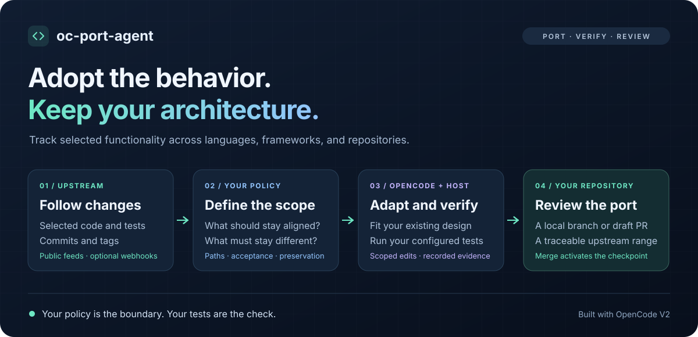

# oc-port-agent

**Adopt upstream behavior. Keep your architecture.**

Use **OpenCode V2** to bring selected functionality into your repository and keep
it aligned as the upstream evolves—even across different languages, frameworks,
or runtime constraints. Define the scope, preserve what makes your project
different, and review a tested proposal before merging.



[Quick start](#quick-start) · [Why](#why-oc-port-agent) · [How it works](#how-it-works) · [Hosted GitHub App](#hosted-github-app) · [Examples](#see-it-in-action) · [Reference](#documentation)

## Why oc-port-agent?

A useful feature often lives in a codebase you cannot adopt wholesale. You want
its retry behavior, parser fix, or test cases, while keeping your own API,
dependencies, and deployment model. After the initial port, every upstream fix
becomes another round of reading diffs, adapting code, and checking for drift.

`oc-port-agent` makes that relationship explicit:

- **Select the behavior:** Describe what should follow upstream and which files
  provide the implementation and test evidence.
- **Keep your design:** Declare target edit boundaries and intentional differences,
  such as a different HTTP library, runtime, or public interface.
- **Maintain the port:** Track an upstream checkpoint and propose relevant updates
  with the source range, adaptation decisions, and verification results attached.

Use it for Rust → TypeScript ports, same-language projects with different
architectures, or a curated set of features from several upstream repositories.

## How it works

1. **Discover:** Find upstream activity and compare the configured branch against
   the saved checkpoint. `--full` also adopts functionality already present upstream.
2. **Select:** Filter the diff by watched paths, then use acceptance criteria to
   guide the adaptation.
3. **Adapt:** Give a restricted OpenCode agent pinned source context and a separate
   target worktree with explicit edit boundaries.
4. **Verify:** The host enforces scope and runs your configured tests and checks.
5. **Review:** Inspect a local proposal branch or draft PR. Merging the verified
   proposal activates its new checkpoint.

Unchanged upstreams make ordinary sync a model-free no-op. Changes outside the
selected paths also avoid model calls. Tests, reports, and human review determine
whether a proposed adaptation is ready to merge.

## Choose how to run it

| Mode | Best for | Update discovery |
| --- | --- | --- |
| **CLI** | First adoption and local, reviewable syncs | Fetches when you run `check` or `sync` |
| **[GitHub Action](docs/github-actions.md)** | Running the CLI in target CI | Manual runs, optional dispatch, daily fallback |
| **[Hosted GitHub App](#hosted-github-app)** | Shared credentials and central monitoring across targets | Public commit/tag feeds, optional push webhooks, daily fallback |

**Status:** Early release. The CLI has completed real OpenCode-backed adoption
and sync examples. The hosted App has offline integration and real workerd SDK
tests; live provider/GitHub/Container execution remains unverified.

## Quick start

### 1. Install from source

You need Node.js 22+, Git, and an installed, authenticated
[OpenCode V2](https://opencode.ai/v2/docs/). The package is not published to npm.

```sh
git clone https://github.com/kyeshmz/oc-port-agent.git
cd oc-port-agent
npm ci
npm run build
npm link
```

### 2. Define what to adopt

Switch to your **target** Git repository, then scaffold its policy:

```sh
cd /path/to/your-target
oc-port-agent init --upstream https://github.com/your-org/reference-project.git --ref main
```

Edit `oc-port-agent.json`. Replace the generated placeholders with actual paths,
observable acceptance criteria, intentional differences, and verification commands.
For example:

```json
{
  "version": 1,
  "upstream": {
    "repository": "https://github.com/your-org/reference-project.git",
    "ref": "main"
  },
  "selections": [{
    "id": "retry-policy",
    "description": "Keep retry and cancellation behavior aligned using our HTTP adapter.",
    "upstreamPaths": ["src/client/**", "tests/client/**"],
    "targetPaths": ["src/network/**", "test/network/**"],
    "acceptance": [
      "Permanent errors never retry.",
      "Cancellation stops pending retries.",
      "Changed behavior has target regression tests."
    ]
  }],
  "preserve": ["Keep the target's public API and authentication adapter."],
  "verification": [
    { "command": "npm", "args": ["run", "typecheck"] },
    { "command": "npm", "args": ["test"] }
  ]
}
```

Use commands your target actually supports. Verification runs in a new worktree;
provision its dependencies through trusted verification steps or your runner.
For more detailed intent, see [goals, adaptation rules, and non-goals](docs/porting-instructions.md).

### 3. Establish a baseline and preview

For **first-time adoption**, acknowledge the current upstream revision, commit
the configuration, and preview all selected functionality:

```sh
oc-port-agent baseline --commit HEAD
git add oc-port-agent.json .gitignore .oc-port/state.json
git commit -m "Configure selected upstream adoption"
oc-port-agent check --full
```

`check` fetches and shows the plan without a model call. The baseline records a
starting point; it does not assert parity. For an existing port, use its known
upstream SHA and the [ongoing-sync workflow](docs/cli-reference.md#baselines-and-first-adoption).

### 4. Adapt, verify, and review

```sh
oc-port-agent sync --full
```

The CLI prints the proposal branch and worktree location. Review the diff,
verification results, and `.oc-port/reports/` evidence, then merge the successful
proposal. Your original checkout stays unchanged during the run.

To publish a **draft PR** instead, authenticate `gh` and run from the freshly
fetched target base:

```sh
oc-port-agent sync --full --pr --repo your-org/target --base main
```

Use this in place of the local-only sync above. See [publication requirements](docs/cli-reference.md#github-draft-prs).

### 5. Keep it aligned

After merging the first proposal, subsequent runs use the saved checkpoint:

```sh
oc-port-agent check
oc-port-agent sync
```

For several upstreams in one target and one proposal, use a
[policy collection](docs/multiple-repositories.md). For recurring runs, choose
the GitHub Action or hosted App below; the CLI does not schedule itself.

## Hosted GitHub App

The experimental [Cloudflare backend](apps/cloudflare/README.md) manages many
registered targets with **one shared provider key and GitHub App credential set**.
Install the App on your target repositories; public upstream owners need no App,
webhook, workflow, or other setup.

A **five-minute cron** checks public GitHub commit and tag Atom feeds, sharing
one watch across registrations of the same source. Conditional requests
avoid downloading unchanged feeds. A changed feed schedules a check of the stored
policy branch; selected-path filtering decides whether model work is needed.
Push webhooks provide an additional fast path when available, and daily
authoritative checks cover missed or unavailable feed updates.

To set it up:

1. Create the Worker, D1 database, and queues using the
   [hosted setup guide](apps/cloudflare/README.md#create-the-cloudflare-resources).
2. Configure the GitHub App and model-provider credentials **once on the Worker**.
3. Install the App on the target repositories you want it to manage.
4. Register each target's policy, upstream branch, and reviewed baseline through
   [`POST /admin/registrations`](apps/cloudflare/README.md#register-an-approved-target).
5. Deploy with the configured cron trigger for feed discovery and recovery.

Inspect shared credential configuration through the authenticated endpoint:

```sh
curl --fail-with-body \
  --header "Authorization: Bearer ${ADMIN_TOKEN}" \
  "${WORKER_URL}/admin/configuration"
```

Feed activity is a wake-up hint; it never changes your tracked branch or adopts a
tag's SHA as a checkpoint. Private upstreams still need authorized read access.
See [monitoring and shared setup](apps/cloudflare/README.md) for deployment details
and current verification limits.

## See it in action

| Example | What it demonstrates |
| --- | --- |
| [Rust upstream](https://github.com/kyeshmz/oc-port-demo-rust) → [TypeScript target](https://github.com/kyeshmz/oc-port-demo-typescript) | Porting retry behavior while preserving target-specific validation and helpers |
| [Recorded adaptation](https://github.com/kyeshmz/oc-port-demo-typescript/commit/d870f98ee66a7b8a5c56bfe4ff2808755722193e) | Generated implementation and regression tests after an upstream retry change |
| [Verification report](https://github.com/kyeshmz/oc-port-demo-typescript/blob/d870f98ee66a7b8a5c56bfe4ff2808755722193e/.oc-port/reports/4ae2bcd679cd-sync-c8355996e97e6bb9b3879468c051c3f246981641.json) | Pinned source range, changed files, and host-executed checks |
| [Public-upstream adoption cases](docs/public-repository-tests.md) | Pinned regex-escaping and BOM-stripping cases using real OpenCode V2 |
| [Multiple upstreams](docs/multiple-repositories.md) | Independent source policies gathered into one verified target proposal |

The Rust → TypeScript demo first failed differential parity after the upstream
changed, then passed after adaptation. Its verified proposal was merged locally,
and a second sync was a model-free no-op. These are published CLI results;
the demo's future sync workflow remains manual-only.

## Documentation

| Guide | Covers |
| --- | --- |
| [CLI and policy reference](docs/cli-reference.md) | All configuration fields, baselines, checkpoints, review, and execution boundaries |
| [Structured porting instructions](docs/porting-instructions.md) | Goals, adaptation guidance, and non-goals |
| [Multiple repositories](docs/multiple-repositories.md) | Collections, independent policies, and explicit skill maintenance |
| [GitHub Actions](docs/github-actions.md) | Workflow setup, provider credentials, triggers, and draft PR publication |
| [Hosted GitHub App](apps/cloudflare/README.md) | Shared credentials, independent upstream monitoring, registration, and Cloudflare setup |
| [Contributing](CONTRIBUTING.md) | Development setup and tests |
| [Research and motivation](docs/research.md) | Related projects and the design rationale |

## Boundaries

- The agent edits selected target paths; the host owns verification, publication,
  and checkpoints. Proposals require review and are never auto-merged.
- Tests and preservation rules are essential. A successful build or model report
  alone does not establish behavioral parity.
- CLI restrictions are workflow guards, not an OS sandbox. Use a trusted,
  isolated runner and review executable verification configuration.
- Large or ambiguous ports stop for explicit decisions instead of silently
  truncating context or discarding source history. Failed worktrees remain
  available for inspection.

See the [execution reference](docs/cli-reference.md#execution-boundaries) and
[hosted limitations](apps/cloudflare/README.md#boundaries-and-known-limitations)
for the detailed behavior.

## License

[MIT](LICENSE)
